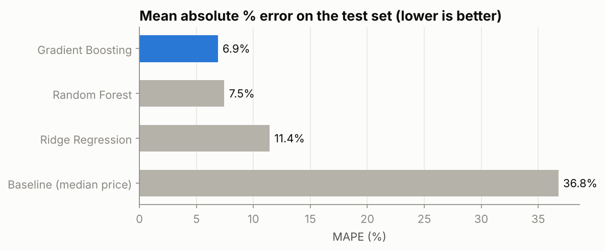
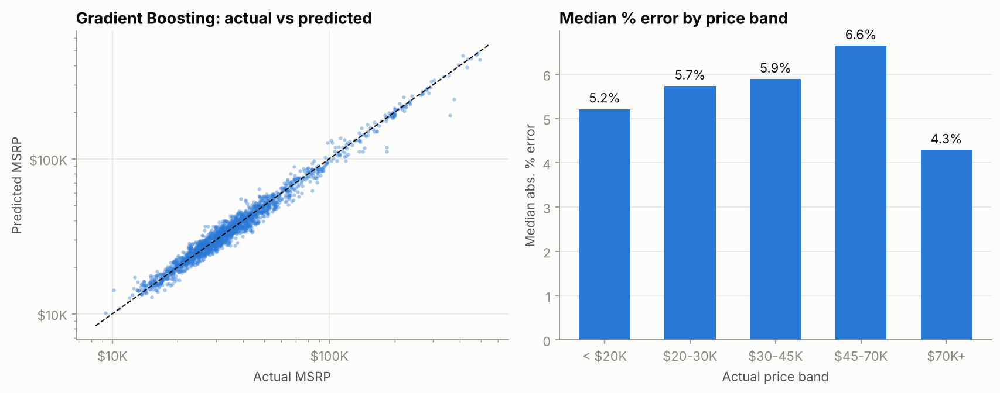
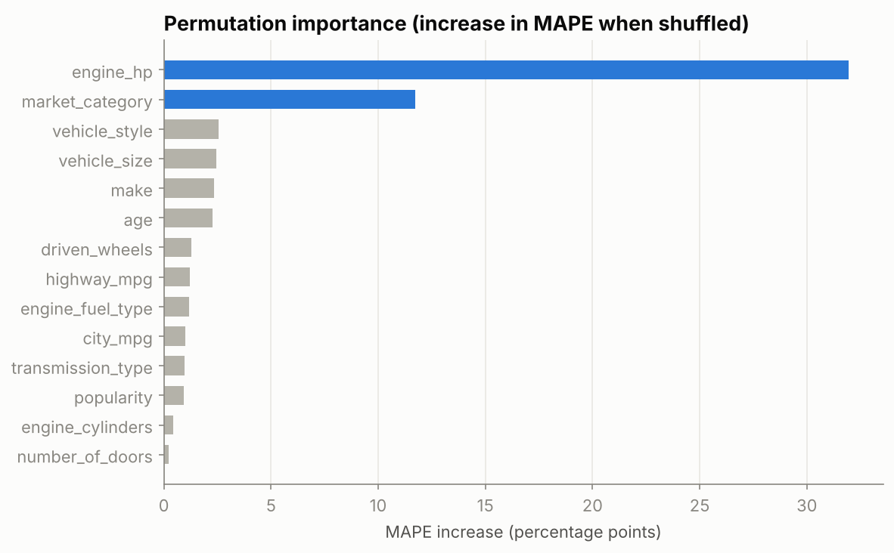
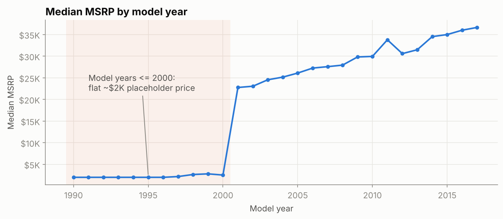

# 🚗 Vehicle Price Prediction

Predicting a car's **MSRP** from its specifications (horsepower, make, body style, fuel economy, ...) with scikit-learn.

The best model, **Gradient Boosting**, prices cars in the test set with a **6.9% mean error**, and **76% of cars land within 10% of their real price**.
On car models it has never seen, the mean error is **10.2%**.



---

## Results

Test set: 1,964 cars (random 80/20 split). All models train on `log(1 + price)` and predict in dollars.

| Model | MAE | MAPE | Within 10% | R² (log price) |
|---|---:|---:|---:|---:|
| Baseline (median price) | $20,796 | 36.8% | 19.5% | -0.02 |
| Ridge Regression | $6,481 | 11.4% | 52.4% | 0.936 |
| Random Forest | $3,316 | 7.5% | 72.4% | 0.973 |
| **Gradient Boosting** | **$3,097** | **6.9%** | **75.6%** | **0.976** |

**Unseen car models.** A random split can put the 2016 Camry in training and the 2017 Camry in test. A stricter split keeps each car model entirely on one side:

| Gradient Boosting | Random split | Unseen car models |
|---|---:|---:|
| MAE | $3,097 | $5,668 |
| MAPE | 6.9% | 10.2% |
| Within 10% | 75.6% | 58.7% |
| R² (log price) | 0.976 | 0.957 |

The free-text `model` name was tested as an extra feature. It slightly improves the random split (MAPE 6.9% → 6.7%) but **hurts** on unseen car models (10.2% → 10.7%), so it's left out.
All numbers are in [`reports/metrics.json`](reports/metrics.json).

<p align="center">
  
</p>

### What drives price?

Permutation importance on the test set, measured on the original columns:



**Horsepower** is the dominant driver, followed by **market category** (luxury, performance, exotic, ...). Body style, size, make and age refine the estimate.

---

## Data quality findings

Data: [Car Features and MSRP](https://www.kaggle.com/datasets/cooperunion/cardataset) on Kaggle (11,914 cars, 16 columns).

| Finding | Action |
|---|---|
| 715 exact duplicate rows | Dropped |
| Cars from model year 2000 or earlier are almost all priced at about **$2,000**, a placeholder rather than a real MSRP | Model scope set to model years 2001 to 2017 |
| 11 hypercars priced at $500K or more (Bugatti, Maybach, ...) | Out of scope, too few to learn from |
| `Market Category` holds comma-separated tags (71 combinations of 10 tags) | Multi-hot encoded |
| `Popularity` has exactly one value per make | Kept, but it carries no information beyond `make` |



Final dataset: **9,820 cars**.

---

## Project structure

```
├── data/
│   └── data.csv                     # Kaggle dataset (+ data/README.md)
├── notebooks/
│   └── vehicle_price_prediction.ipynb  # Full analysis, executed with outputs
├── src/vehicle_price/
│   ├── config.py      # paths, feature lists, scope rules
│   ├── data.py        # loading + cleaning
│   ├── features.py    # leak-free ColumnTransformer, multi-hot encoder
│   ├── models.py      # baseline, Ridge, Random Forest, Gradient Boosting
│   ├── evaluate.py    # metrics in log space and dollars
│   ├── train.py       # train, compare, save best model
│   └── predict.py     # CLI for new predictions
├── reports/
│   ├── figures/       # all charts
│   ├── metrics.json
│   └── model_comparison.csv
└── tests/             # pytest
```

## Quick start

```bash
git clone https://github.com/YoussefSaeed1/vehicle-price-prediction.git
cd vehicle-price-prediction
pip install -r requirements.txt
pip install -e .

# Train all models, print the comparison, save the best one to models/
python -m vehicle_price.train

# Predict a price
python -m vehicle_price.predict --json '{"Make": "Toyota", "Year": 2017, "Engine HP": 178,
  "Engine Cylinders": 4, "Transmission Type": "AUTOMATIC", "Driven_Wheels": "front wheel drive",
  "Number of Doors": 4, "Vehicle Size": "Midsize", "Vehicle Style": "Sedan",
  "highway MPG": 33, "city mpg": 24, "Popularity": 2031, "Engine Fuel Type": "regular unleaded"}'

# Run tests
pytest
```

Any missing field is imputed by the pipeline, so partial inputs work too (with lower accuracy).

## Methodology

1. **Cleaning:** standardize column names, lower-case text, drop duplicates, add `age = 2017 - year`, then apply the scope rules above.
2. **Preprocessing,** inside a scikit-learn `Pipeline` so it's fitted on training rows only:
   - numeric: median imputation, plus standard scaling for Ridge
   - categorical: most-frequent imputation and one-hot encoding (categories with fewer than 5 cars are grouped)
   - market category: multi-hot encoding
3. **Target:** `TransformedTargetRegressor` with `log1p` / `expm1`, so models learn on log price and report in dollars.
4. **Models:** median baseline, Ridge, Random Forest (300 trees), and Histogram Gradient Boosting.
5. **Evaluation:** random 80/20 hold-out, plus a group split by car model to test generalization.

## Changes from the first version

This started as my final project for **DS588: Advanced Programming for Data Science** (Faculty of Graduate Studies for Statistical Research, Cairo University). A review of the original notebook turned up issues that made its scores look better than they really were:

- **Feature list was overwritten.** `cat_cols = df.select_dtypes("object").columns` replaced the chosen four columns, so the model actually used all eight text columns, including `model` (915 names), and silently dropped `number_of_doors`.
- **Preprocessing leaked.** The scaler and encoder were fitted on the full dataset before the train/test split.
- **The outlier filter was never applied.** A filtered `df_Cleaned` was created, but the models trained on the unfiltered `df`.
- **Placeholder prices inflated R².** About 1,650 pre-2001 cars priced at ~$2,000 made "old = cheap" trivially easy to learn.
- **Metrics were reported on the log scale only.** Nothing showed the error in dollars or percent.

The original reported R² = 0.986 (log scale). This version reports R² = 0.976 on a harder, cleaner problem, along with dollar and percentage errors and an unseen-model test.

## Limitations

- These are MSRP list prices from US data (2001 to 2017 in scope), not used-car market prices.
- Trims of the same model often share specs, so options and packages that change the price aren't visible to the model.

## Author

**Youssef Saeed** · [LinkedIn](https://www.linkedin.com/in/youssef-saeed1) · [Portfolio](https://youssefsaeed-portfolio.vercel.app)

License: MIT
